# Sécurisation d'une infrastructure réseau sur AWS

Projet de session du cours **Sécurité des réseaux informatiques (CYB1023)**, Université du Québec en Outaouais, automne 2025.

Conception et déploiement d'une architecture réseau d'entreprise sur AWS : segmentation en DMZ et réseau privé, pare-feu à deux niveaux, haute disponibilité en HTTPS, accès distant par VPN et détection d'intrusions avec journaux centralisés.

> **English summary:** Team course project: a segmented AWS network with a DMZ and a private subnet, layered firewalls (Network ACLs and security groups), a load-balanced HTTPS website across two Availability Zones, OpenVPN remote access, and Snort intrusion detection with logs sent to CloudWatch.

**Équipe :** Oumarou Okiobe, Armelle Kadji Nitcheu, Alpha Boubacar Diallo

## Technologies

| Domaine | Outils |
|---|---|
| Réseau | Amazon VPC, sous-réseaux, passerelle Internet, passerelle NAT, tables de routage |
| Pare-feu | Network ACL (sans état), groupes de sécurité (avec état) |
| Haute disponibilité | EC2, Application Load Balancer, Route 53, AWS Certificate Manager |
| Accès distant | OpenVPN, Easy-RSA, Ubuntu Server |
| Détection et surveillance | Snort 2.9.20, Amazon CloudWatch Agent, CloudWatch Logs |

## Architecture

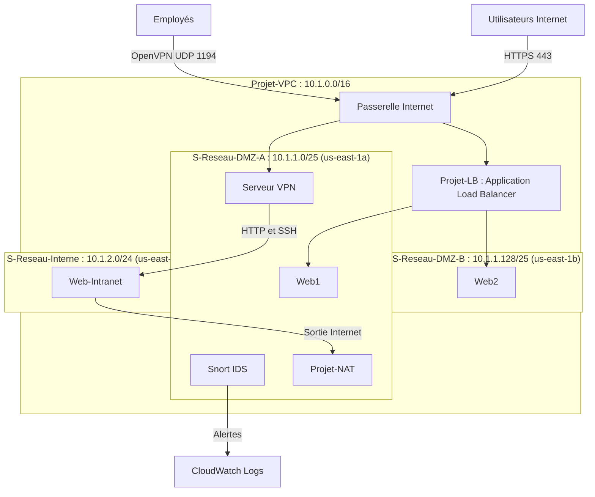

## Réalisations

### 1. Infrastructure réseau

- VPC `10.1.0.0/16` avec deux sous-réseaux publics dans deux zones de disponibilité et un sous-réseau privé.
- Table de routage publique vers la passerelle Internet.
- Table de routage privée vers la passerelle NAT, pour que le serveur intranet sorte sans être exposé.

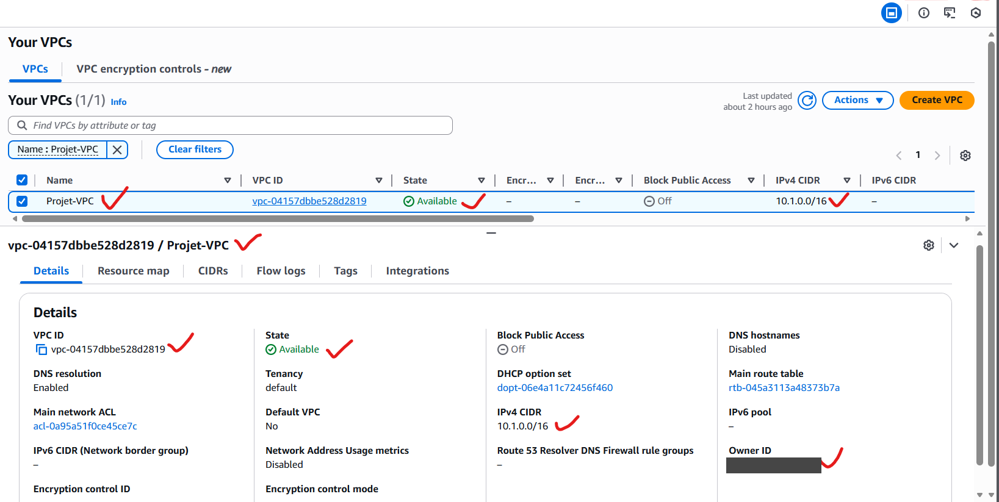

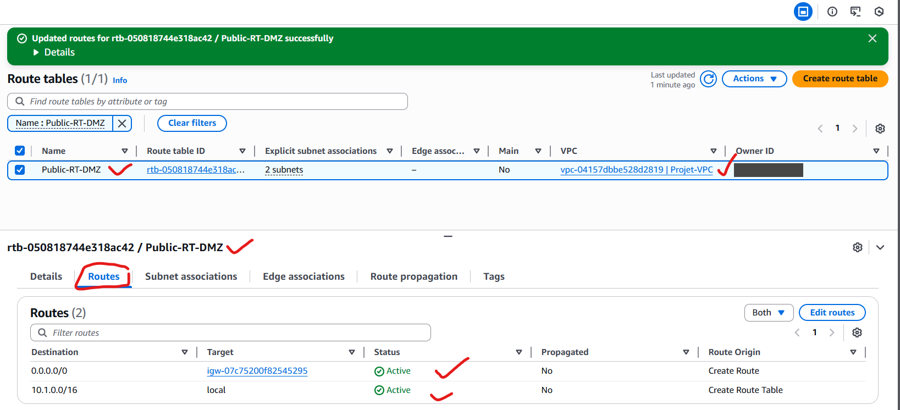

### 2. Pare-feu à deux niveaux

**Network ACL, sans état, à l'entrée de chaque sous-réseau :**

| ACL | Sous-réseau | Trafic entrant autorisé |
|---|---|---|
| `ACL-DMZ-A` | S-Reseau-DMZ-A | HTTPS, SSH, ICMP, UDP 1194, UDP 4789, ports 1024-65535 |
| `ACL-DMZ-B` | S-Reseau-DMZ-B | HTTPS, SSH, ICMP, UDP 4789, ports 1024-65535 |
| `ACL-Prive` | S-Reseau-Interne | SSH et HTTP depuis `10.1.1.0/25`, UDP 4789 depuis le VPC, ports 1024-65535 |

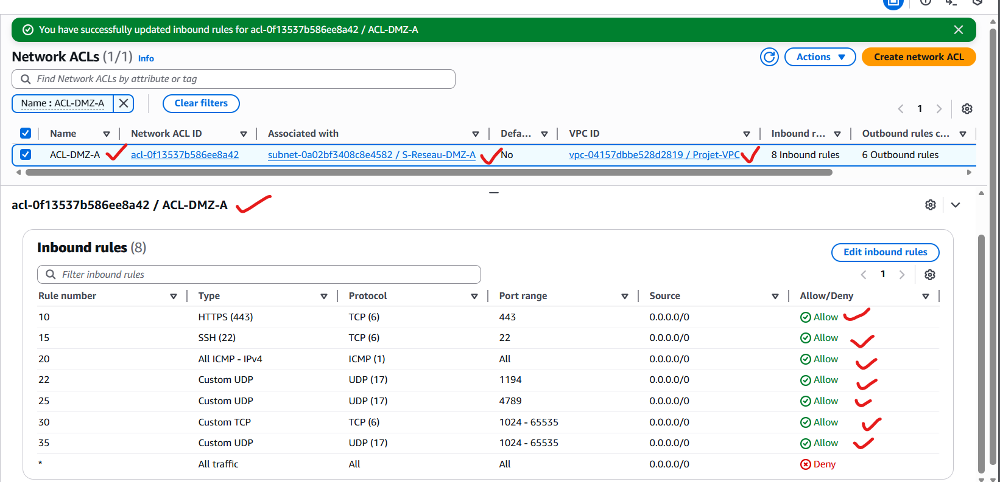

**Groupes de sécurité, avec état, au niveau des instances :**

| Groupe | Protège | Trafic entrant autorisé |
|---|---|---|
| `SG-LB` | Load Balancer | HTTPS depuis Internet |
| `SG-Web` | Web1, Web2 | HTTPS depuis `SG-LB`, SSH et ICMP depuis `SG-VPN` |
| `SG-VPN` | Serveur VPN | UDP 1194, SSH et ICMP depuis Internet |
| `SG-IDS` | Snort | SSH depuis `SG-VPN` |
| `SG-Prive` | Web-Intranet | HTTP et SSH depuis `SG-VPN` |

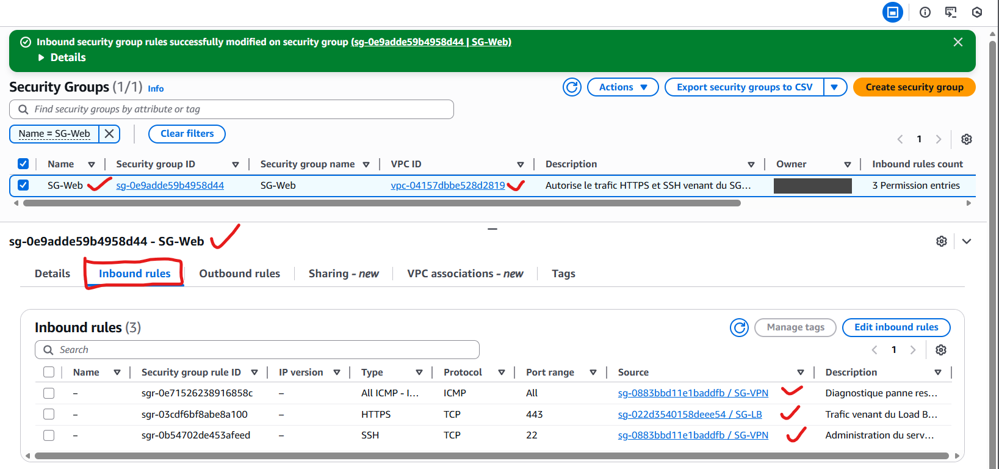

### 3. Haute disponibilité et HTTPS

- Domaine enregistré avec Route 53 et certificat public émis par AWS Certificate Manager (RSA 2048, validation DNS).
- Application Load Balancer réparti sur `us-east-1a` et `us-east-1b`, avec Web1 et Web2 comme cibles.
- Redirection du trafic HTTP vers HTTPS.

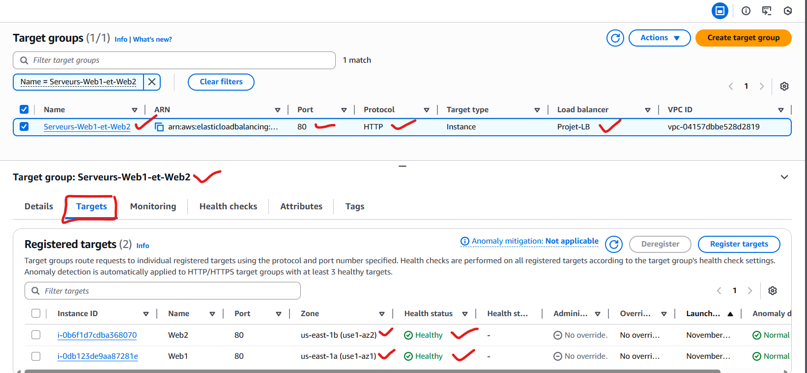

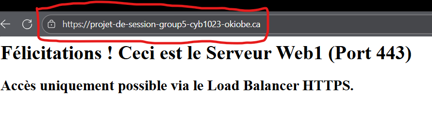

### 4. Accès distant par VPN

- Infrastructure à clés publiques créée avec Easy-RSA : autorité de certification, certificats serveur et client.
- Clé TLS partagée pour renforcer la protection du canal.
- Serveur OpenVPN sur Ubuntu, puis connexion testée depuis OpenVPN Connect.

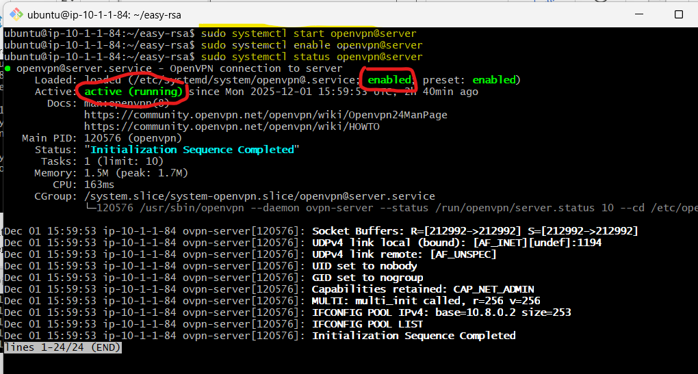

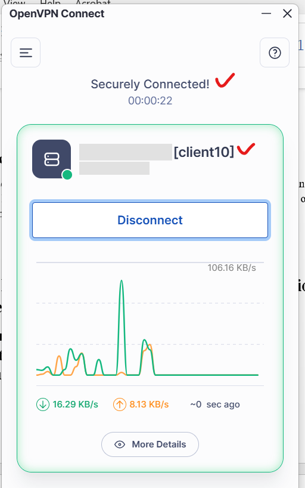

### 5. Détection d'intrusions et surveillance

- Snort configuré avec `HOME_NET` à `10.1.0.0/16`.
- Scan simulé avec `nmap -A -T4`, détecté par Snort (alertes `ICMP PING NMAP` et `SCAN nmap XMAS`, entre autres).
- Alertes envoyées vers le groupe de journaux CloudWatch `snort-alerts` par l'agent CloudWatch.

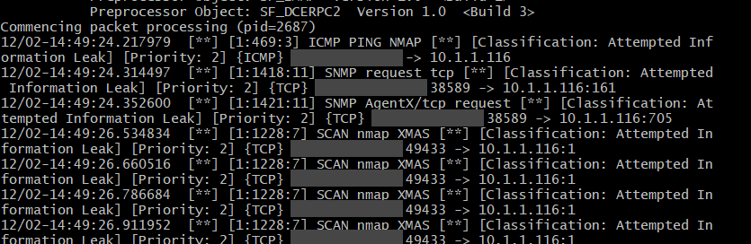

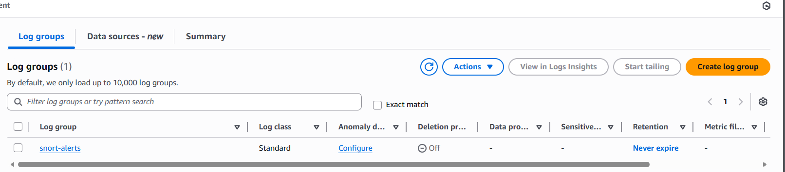

## Limites et améliorations possibles

- **Accès SSH :** `SG-VPN` accepte SSH depuis toutes les adresses, car le cahier des charges ne précisait pas le réseau des employés. En production, il faudrait le restreindre à des plages connues.
- **Tests de validation :** les tests finaux ont été réalisés pendant la présentation du projet, et leurs résultats ne figurent donc pas dans le rapport.
- **Alarme CloudWatch :** le rapport ne documente pas la configuration d'une alarme sur événement critique. Ce serait la prochaine étape.

## Note sur les captures

Les captures proviennent du rapport du projet. Les identifiants de compte AWS, les noms d'utilisateur et les adresses IP publiques y ont été masqués ou retirés.
